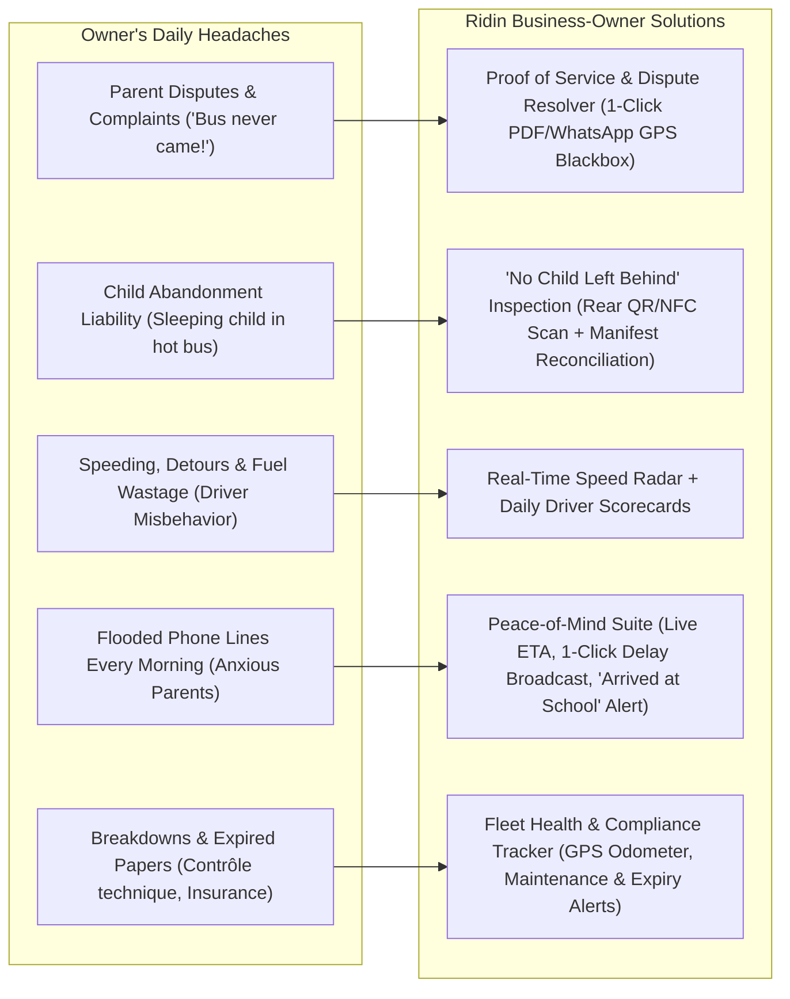
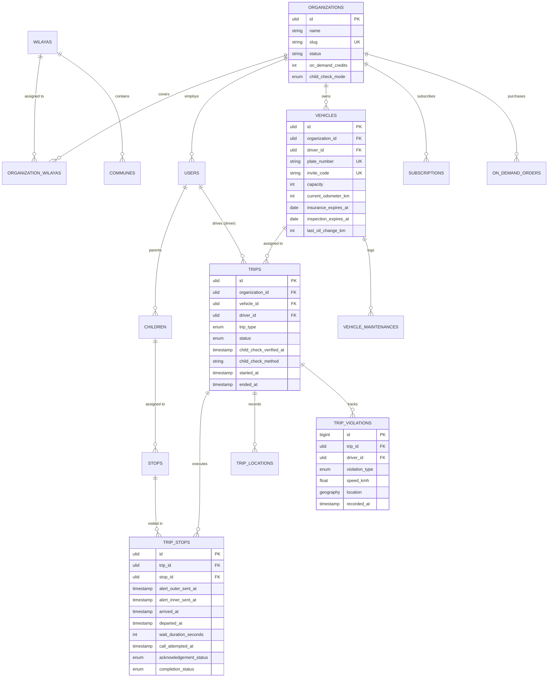
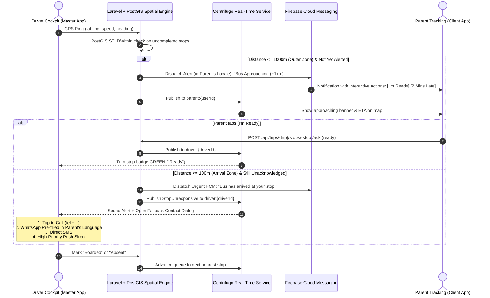
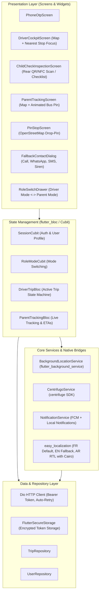
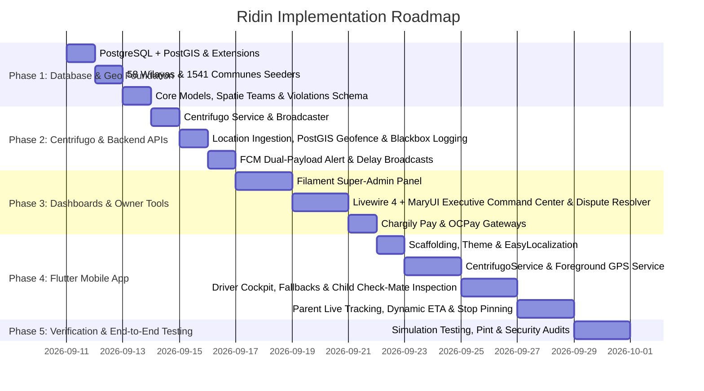

# Ridin: System Architecture Diagrams

This document contains all formal Mermaid architectural diagrams preserving the complete design of the **Ridin** platform, including the Business Owner Protection & Fleet Value Suite.

---

## 1. Owner Value Proposition & Problem-Solving Flowchart

---

## 2. Multi-Tier High-Level Architecture & Communication Topology

```mermaid
flowchart TD
    subgraph SuperAdminLayer["Platform Super-Admin (Platform Owner)"]
        FilaPanel["Filament Admin Dashboard (/super-admin) [Guard: admin]"]
        FilaPanel -->|"Manages"| TenancyMgmt["Organizations & Subscription Billing"]
        FilaPanel -->|"Manages"| GeoData["58 Wilayas & 1541 Communes"]
        FilaPanel -->|"Configures"| Gateways["Payment Gateways (Chargily, OCPay, CCP)"]
        FilaPanel -->|"Subscribes"| GlobalRadarSub["Centrifugo: platform:fleet"]
    end

    subgraph BusinessAdminLayer["Business Admin (School / Fleet Owner)"]
        LivewirePortal["Custom Livewire Portal (Flux + MaryUI) [Guard: web + Spatie Teams]"]
        LivewirePortal -->|"Monitors"| ExecDashboard["Executive ROI & Safety Command Center"]
        LivewirePortal -->|"Generates"| DisputeReports["1-Click Dispute Resolver (PDF/WhatsApp)"]
        LivewirePortal -->|"Tracks"| FleetHealth["Fleet Health & Compliance (Odometer, Insurance, Contrôle)"]
        LivewirePortal -->|"Dispatches & Ends"| TripDispatch["Daily Routes & On-Demand Trips (Manual Lifecycle)"]
        LivewirePortal -->|"Approves/Rejects"| StopApprovalQueue["Parent Pickup Stop Map Queue"]
        LivewirePortal -->|"Subscribes"| OrgFleetSub["Centrifugo: org:{orgId}:fleet"]
    end

    subgraph BackendEngine["Core Backend (Laravel 13 + PostgreSQL + PostGIS)"]
        Postgres[(PostgreSQL + PostGIS)]
        CentrifugoBroadcaster["CentrifugoBroadcaster (Mindcare Pattern)"]
        SpatialEngine["PostGIS Proximity Engine (ST_DWithin)"]
        FCMService["Firebase Cloud Messaging (FCM)"]
        PaymentManager["GatewayManager (Chargily / OCPay / CCP)"]
    end

    subgraph CentrifugoLayer["Centrifugo Real-Time Service (Go + Redis Engine)"]
        CentrifugoServer["Centrifugo Server (WSS: /connection/websocket)"]
        RedisPubSub[(Redis Engine)]
        CentrifugoServer <--> RedisPubSub
    end

    subgraph MobileAppLayer["Unified Mobile App (Flutter)"]
        DriverApp["Master: Driver Cockpit (Foreground Service GPS)"]
        ParentApp["Client: Parent Tracking (Live Map & ETA)"]
    end

    DriverApp -->|"1. GPS Pings (REST POST every 3-5s)"| SpatialEngine
    SpatialEngine -->|"2. ST_DWithin & Spatial Logs"| Postgres
    SpatialEngine -->|"3. HTTP Publish (API Key)"| CentrifugoBroadcaster
    CentrifugoBroadcaster -->|"4. Publish payload"| CentrifugoServer
    SpatialEngine -->|"5. Outer 1000m / Inner 100m Alerts (Guard against stale pings)"| FCMService

    CentrifugoServer -->|"6. Broadcast trip:{id} pins (<5ms)"| ParentApp
    CentrifugoServer -->|"6b. Broadcast org:{id}:fleet"| LivewirePortal
    CentrifugoServer -->|"6c. Broadcast platform:fleet"| FilaPanel
    FCMService -->|"7. Approaching & Arrival Alerts (Parent Locale)"| ParentApp

    ParentApp -->|"8. Acknowledge [Ready / 2 Mins Late]"| SpatialEngine
    ParentApp -->|"8b. Mark 'Absent Today' (Auto-skips stop)"| SpatialEngine
    SpatialEngine -->|"9. Publish driver:{driverId}"| CentrifugoBroadcaster
    CentrifugoBroadcaster -->|"10. StopAcknowledged / StopSkipped event"| CentrifugoServer
    CentrifugoServer -->|"11. Green Badge (Ready) / Gray (Absent)"| DriverApp
    DriverApp -->|"12. If 100m Unresponsive: Fallback Call/WhatsApp/SMS/Siren"| ParentApp
    DriverApp -->|"13. End of Trip: Rear QR/NFC Scan + Safety Checklist"| SpatialEngine
```

---

## 3. PostgreSQL + PostGIS Database Entity Relationship Diagram

---

## 4. Two-Zone Geofence & Fallback Communication Sequence Diagram

---

## 5. Mobile Application Layered Architecture (Flutter)

---

## 6. Phased Implementation Roadmap (Gantt Chart)

